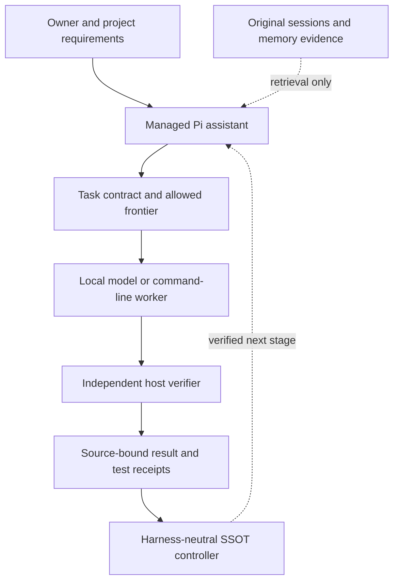

# Low-VRAM Agentic Harness

**Local-first agents for projects that outlive a chat session.**

Your model can change. Your project's decisions, evidence and verification rules should not.

[](https://github.com/scruge1/lowvram-agentic-harness/actions/workflows/offline-release.yml)
[](LICENSE)

A development-stage, self-hostable toolkit for running **supervised AI agents with locally served models**. The managed assistant uses [Pi](https://github.com/earendil-works/pi); an independent, harness-neutral project controller preserves the task contract, source evidence and verification receipts. Low-VRAM inference guidance and hardware inspection are included, but no model weights or universal performance claims are bundled.

**[Get started](GETTING-STARTED.md) · [How it works](#how-it-works) · [Current limits](#what-is-and-isnt-ready) · [Developer toolkit](TOOLKIT.md)**

> **Development status:** The portable controller has passing offline acceptance tests. The complete managed assistant and its first useful local-model report remain under qualification. This is not a production-ready autonomous agent or a finished desktop app.

## Why this exists

Many agent workflows lose the reasoning behind a project when the model changes, context compacts, or a session ends. A successful tool call can also be mistaken for a completed task.

This project separates **remembering, doing and accepting work**. Sessions and memory are retrieval evidence; the task and its current source files define what is allowed; an independent host-side verifier checks actual outputs. A model cannot approve its own completion.

| Problem | Included public capability |
| --- | --- |
| A long project outlives a model session | Managed Pi sessions, project identity, task board, explicit resume and [cross-assistant handoff](CROSS-ASSISTANT-CONTINUITY.md) |
| Tool output consumes too much context | Stable Pi prompt sections, bounded source-hash-paginated tool replies and native compaction lifecycle checks |
| Old memories contradict newer ones | Opt-in [bidirectional Dream review](MEMORY-DREAM.md) and a [validated retrieval interface](adapters/pi/memory/README.md); review suggestions **do not** overwrite accepted memory |
| An agent says "done" before work is verified | [Independent SSOT controller](BLESSED-SSOT.md), source-bound receipts and [supervised task enforcement](ENFORCEMENT.md) |
| A large model may not fit available VRAM | [Hardware probing and measured CPU/MoE offload](TOOLKIT.md) plus [read-only GGUF/GPU inventory](DYNAMIC-MODEL-INVENTORY.md) |

The individual components can be used independently. You do not need the experimental full profile to use the default assistant or the offline verification toolkit.

## Quick start

The **complete bootstrap is for Linux x86_64 with glibc**. It attaches to an *existing* local OpenAI-compatible model endpoint; supply the exact server address and model ID. Model downloads are separate from the default installation.

```bash
git clone https://github.com/scruge1/lowvram-agentic-harness.git
cd lowvram-agentic-harness

# Inspect the plan before creating a home.
bash install.sh --home /data/my-agent --plan

# Then run the interactive install when ready.
bash install.sh
```

Choose a **new, dedicated Home folder** with room for its adjacent runtime folder, memory cache, browser and packages. Installation does not silently adopt existing project folders or memory databases. See [Getting started](GETTING-STARTED.md) for storage requirements, personalization, an explicit CPU-only candidate, launching, the first checked report and repair.

After installation, using the example Home above:

```bash
/data/my-agent/bin/harness-agent --status
/data/my-agent/bin/harness-agent
```

**Windows and macOS:** The [smaller direct-install route](AGENT-HOME.md#run-from-a-repository-checkout) has different capabilities and lifecycle qualifications. Do not assume parity with the Linux bootstrap.

### Try the verification contract without a model

The repository also contains an offline, harness-neutral source/receipt example. With Python and the repository's test dependencies configured, run:

```bash
python scripts/verify_ssot_release.py
```

That checks the portable project's controlled execution and independent acceptance path, without requiring a GPU or paid model API. It **does not** prove a useful end-to-end response from whichever model you later configure. GitHub's [offline release workflow](https://github.com/scruge1/lowvram-agentic-harness/actions/workflows/offline-release.yml) runs the release gate and lint on Ubuntu/Python 3.11 and Windows/Python 3.13.

## How it works



**Pi runs the conversation and tools; the project-owned controller decides what the evidence establishes.** An independently tested local result is capped at `tested`; it cannot self-promote to externally `blessed`. See the [SSOT trust boundary](BLESSED-SSOT.md), [supervised enforcement](ENFORCEMENT.md) and [Pi adapter documentation](adapters/pi/project-workflow/README.md).

## What is and isn't ready

| Available in public source | Not claimed or not yet qualified |
| --- | --- |
| Managed Pi CLI, explicit project selection, bounded context, safe resume and task-board adapters | A finished ChatGPT-style desktop/mobile application |
| Source-bound memory retrieval and deterministic Dream candidate review | Automatic memory promotion, a fully trained autonomous memory chief or complete ChatGPT/Gemini/Claude history import |
| Read-only inventory of model files and NVIDIA GPUs; optional measured offload tooling | Automatic GPU leasing, eviction, model swapping or universal low-VRAM fit |
| Offline SSOT/verifier gates and model-independent task contracts | Unattended project completion across arbitrary hosts or independently accepted first-report quality from the local CPU candidate |

The default agent profile includes Pi, Hermes, MemPalace, Microsoft Agent Framework and research tools; the Claude-mem observer and experimental additional packages are opt-in. Web research may contact external sites when enabled. The local-first model does **not** mean every optional tool is offline.

## Continue, inspect and contribute

**User guidance:** [Getting started](GETTING-STARTED.md) · [Agent Home and lifecycle](AGENT-HOME.md) · [Project continuity](CROSS-ASSISTANT-CONTINUITY.md) · [Diagnostics](DIAGNOSTICS.md)

**Developer reference:** [Toolkit](TOOLKIT.md) · [SSOT and trust boundary](BLESSED-SSOT.md) · [Current release checks](RELEASE-CHECKLIST.md) · [Upgrade history](UPGRADES.md) · [Research setup](RESEARCH-SETUP.md)

Contributions and reproducible failure reports are welcome. See [Contributing](CONTRIBUTING.md) and [Security policy](SECURITY.md). Please do not put private conversations, credentials, rig-specific source maps or model weights into public issues or pull requests.

Core code is [MIT licensed](LICENSE). Installed third-party packages retain their own licenses; see the [runtime notices](harness/BOOTSTRAP-NOTICES.md).
