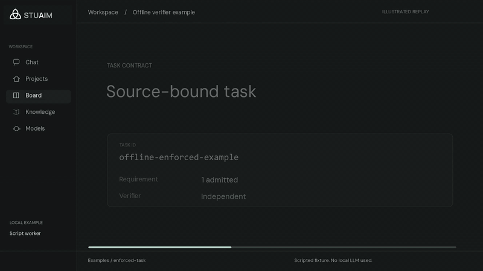
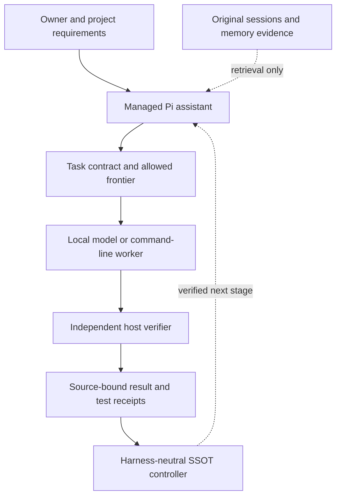

<p align="center">
  <picture>
    <source media="(prefers-color-scheme: dark)" srcset="docs/media/stuaim/stuaim-horizontal-dark.png">
    
  </picture>
</p>

# Low-VRAM Agentic Harness

This repository contains the public command-line harness and project controller behind the STUAIM work. The managed assistant connects Pi to an existing local model endpoint. The independent controller checks task outputs before recording their status.

The STUAIM desktop interface is still being developed and qualified. The branding and UI images here are design studies, not screenshots of a released desktop application.

[](https://github.com/scruge1/lowvram-agentic-harness/actions/workflows/offline-release.yml)
[](LICENSE)

[Getting started](GETTING-STARTED.md) · [Project verification](BLESSED-SSOT.md) · [Developer toolkit](TOOLKIT.md) · [STUAIM visual assets](docs/STUAIM-BRANDING.md)

## Offline verifier example

[](docs/WORKFLOW-DEMO.md)

The bundled example runs a scripted worker. Its first result was rejected by the verifier, and the retry passed using the recorded feedback. The controller then set the local project status to `tested`.

[Read the reproducible example](docs/WORKFLOW-DEMO.md) · [Download the full MP4](https://raw.githubusercontent.com/scruge1/lowvram-agentic-harness/main/docs/media/source-backed-workflow.mp4)

The animation uses the STUAIM visual design to explain real public test results. It is an illustration; the test did not involve the desktop interface or a language model.

## Quick start

The **complete bootstrap is for Linux x86_64 with glibc**. It attaches to an *existing* local OpenAI-compatible model endpoint; supply the exact server address and model ID. Model downloads are separate from the default installation.

```bash
git clone https://github.com/scruge1/lowvram-agentic-harness.git
cd lowvram-agentic-harness

# Inspect the plan before creating a home.
bash install.sh --home /data/my-agent --plan

# Then run the interactive install when ready.
bash install.sh
```

Choose a **new, dedicated Home folder** with room for its adjacent runtime folder, memory cache, browser and packages. Installation does not silently adopt existing project folders or memory databases. See [Getting started](GETTING-STARTED.md) for storage requirements, personalization, an explicit CPU-only candidate, launching, the first checked report and repair.

**Using an existing coding assistant?** Ask it to *read `GETTING-STARTED.md`, inspect your machine using the read-only install plan, and explain the exact requirements before installing anything.* It should not guess your model, silently change running services or treat a successful install as proof that the agent can complete your task.

After installation, using the example Home above:

```bash
/data/my-agent/bin/harness-agent --status
/data/my-agent/bin/harness-agent
```

**Windows and macOS:** The [smaller direct-install route](AGENT-HOME.md#run-from-a-repository-checkout) has different capabilities and lifecycle qualifications. Do not assume parity with the Linux bootstrap.

### Try the verification contract without a model

The repository also contains an offline, harness-neutral source/receipt example. With Python and the repository's test dependencies configured, run:

```bash
python scripts/verify_ssot_release.py
```

That checks the portable project's controlled execution and independent acceptance path, without requiring a GPU or paid model API. It **does not** prove a useful end-to-end response from whichever model you later configure. GitHub's [offline release workflow](https://github.com/scruge1/lowvram-agentic-harness/actions/workflows/offline-release.yml) runs the release gate and lint on Ubuntu/Python 3.11 and Windows/Python 3.13.

## How it works



**Pi runs the conversation and tools; the project-owned controller decides what the evidence establishes.** An independently tested local result is capped at `tested`; it cannot self-promote to externally `blessed`. See the [SSOT trust boundary](BLESSED-SSOT.md), [supervised enforcement](ENFORCEMENT.md) and [Pi adapter documentation](adapters/pi/project-workflow/README.md).

## What is and isn't ready

| Available in public source | Not claimed or not yet qualified |
| --- | --- |
| Managed Pi CLI, explicit project selection, bounded context, safe resume and task-board adapters | A finished ChatGPT-style desktop/mobile application |
| Source-bound memory retrieval and deterministic Dream candidate review | Automatic memory promotion, a fully trained autonomous memory chief or complete ChatGPT/Gemini/Claude history import |
| Read-only inventory of model files and NVIDIA GPUs; optional measured offload tooling | Automatic GPU leasing, eviction, model swapping or universal low-VRAM fit |
| Offline SSOT/verifier gates and model-independent task contracts | Unattended project completion across arbitrary hosts or independently accepted first-report quality from the local CPU candidate |

The default agent profile includes Pi, Hermes, MemPalace, Microsoft Agent Framework and research tools; the Claude-mem observer and experimental additional packages are opt-in. Web research may contact external sites when enabled. The local-first model does **not** mean every optional tool is offline.

## Continue, inspect and contribute

**User guidance:** [Getting started](GETTING-STARTED.md) · [Agent Home and lifecycle](AGENT-HOME.md) · [Project continuity](CROSS-ASSISTANT-CONTINUITY.md) · [Diagnostics](DIAGNOSTICS.md)

**Developer reference:** [Toolkit](TOOLKIT.md) · [SSOT and trust boundary](BLESSED-SSOT.md) · [Current release checks](RELEASE-CHECKLIST.md) · [Upgrade history](UPGRADES.md) · [Research setup](RESEARCH-SETUP.md)

Contributions and reproducible failure reports are welcome. See [Contributing](CONTRIBUTING.md) and [Security policy](SECURITY.md). Please do not put private conversations, credentials, rig-specific source maps or model weights into public issues or pull requests.

Core code is [MIT licensed](LICENSE). Installed third-party packages retain their own licenses; see the [runtime notices](harness/BOOTSTRAP-NOTICES.md).
