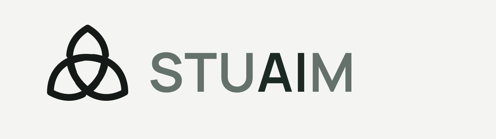
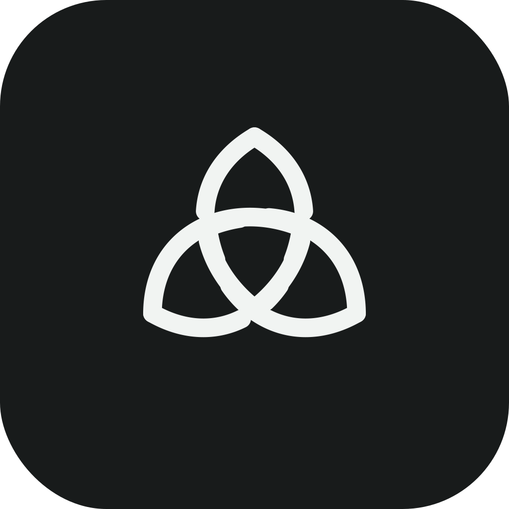
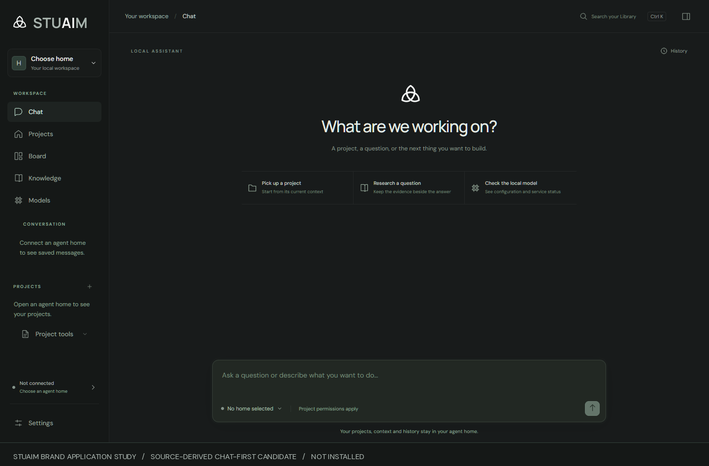
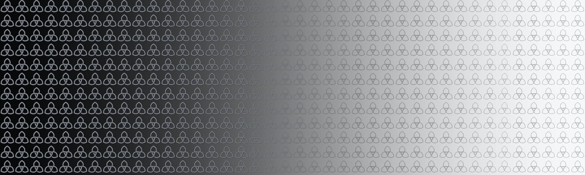

# STUAIM visual assets

These are the retained **design-review assets** for the Agent Home desktop
workstream, reused to make the public harness easier to recognise.
They are not evidence that the desktop build is installed, released or
available from this repository.

## Wordmark and app icon

<picture>
  <source media="(prefers-color-scheme: dark)" srcset="media/stuaim/stuaim-horizontal-dark.png">
  
</picture>

The wordmark keeps **AI** brighter and the other letters grey. The same
three-loop mark is used for the app icon and the sidebar.

The active design files come from the separately tested STUAIM frontend
branch, commit `89ee9c8`, and its prior Round 03 visual study. This
public repo intentionally does not include the private Tauri source,
native app binaries, development transcripts, source fonts or full
project directories.

## Source-derived interface study

This is an **uninstalled, browser-tested frontend candidate**. It shows
the visual system; it is not a screenshot of completed agent execution.
The sidebar, chat panel and model labels are based on the original
Agent Home frontend. The wider desktop functional qualification and
final product identity remain separate.

The renderer for the public workflow demo uses the current source
palette: page `#181b1b`, sidebar `#151817`, panels `#1e2221`,
text `#e7e9e8`, muted status accent `#b1d0c1`. Manrope is used
for the wordmark and DM Sans for application text in the original
frontend. The still and film include rendered typography but **no
font binaries**.

## Flat knot banner study

This is a retained *working concept*, not an approved application
background. Its source geometry is a flat orthographic 40×12 grid,
with 240 knots on each half. It has no curved plane, perspective,
glow or asymmetric density. The public 1600-pixel preview is the
original design study; the full editable master stays with the
owner's design archive. It is not layered over the primary
installation or demo screenshots.

## Wording and evidence

The public video uses status and field names from the executed
`examples/enforced-task` fixture. Its most important findings are
`Attempt 01: rejected`, `Attempt 02: accepted` and local
`authority: tested`. Colour conveys actual outcome/status,
not an arbitrary highlighted word in every line.

Avoid slogan-like claims and rhetorical line breaks. The README
should explain what the software does in ordinary sentences. A
static design study must not become a functional screenshot through
new captions or montage editing.

The [reproducible verifier demonstration](WORKFLOW-DEMO.md) contains
the underlying fixture, source hashes, video and qualification limits.
Final STUAIM branding approval, trademark/domain clearance and the
desktop cutover are tracked separately in
[issue #94](https://github.com/scruge1/lowvram-agentic-harness/issues/94).
