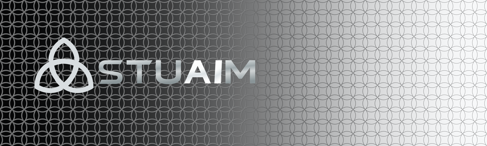

# STUAIM design system

The product is **STUAIM**. The symbol and geometry originate from the owner’s rig-side
brand work, not a generative replacement of the source assets.

## Product identity

The design has one geometry source: the 40 × 12 equal-pitch vesica lattice.
There are 240 motifs in each half, with no perspective compression, curved plane,
glow or extra knots on the right. The black/graphite surface transitions to silver
and white by changing material and relief, not the cell layout.

The wordmark uses **six original SVG glyph outlines**, not a default font.
The A and I are distinguished by a brighter metallic value.
No font file is needed to render the wordmark.

## Assets

[Editable STUAIM custom glyphs](media/stuaim/stuaim-custom-wordmark.svg) ·
[Vector logo lockup](media/stuaim/stuaim-vector-lockup.svg) ·
[1024-pixel application icon](media/stuaim/stuaim-app-icon-1024.png) ·
[Design provenance](media/stuaim/SOURCE-MANIFEST.json)

The standalone app icon retains the three-loop Celtic knot above a subtle,
recurring embossed background. Its source symbol remains flat and legible at small
desktop sizes; use the pattern for larger surfaces rather than shrinking tile cells
in individual icons.

## Interface and demonstrations

STUAIM uses neutral black, charcoal, steel and white in the brand identity.
Functional readouts may use the app's existing subdued green for verified state.
A separate [scripted verifier demonstration](WORKFLOW-DEMO.md) describes
its evidence and limitations; it must never be presented as a recording of
a working multi-agent desktop session.

The source-of-truth code for the graphic renders is retained in the author's rig
asset workspace. The public gallery contains rendered, editable vector assets and
the source audit, but no private source fonts, host paths or deployment credentials.
