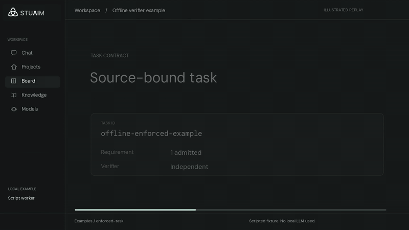

# Offline task verification example



This animation is based on the actual public
[enforced-task example](../examples/enforced-task/README.md). It uses
the STUAIM visual design from the [branding study](STUAIM-BRANDING.md)
rather than the older teal-and-orange graphics. The animation is a
constructed explanation of the recorded results, **not an application
screen recording**.

[Download the 22-second MP4](https://raw.githubusercontent.com/scruge1/lowvram-agentic-harness/main/docs/media/source-backed-workflow.mp4) ·
[View the source results](media/workflow-evidence.json) ·
[Reproduce the test](../examples/media/source-backed-workflow/capture.py)

## Recorded test

The example uses a scripted command-line worker. Its first output was
rejected by the independent verifier, which returned exit code `1`.
The second attempt used the recorded feedback and passed with exit code
`0`. The project acceptance check then recorded a verified stage and
a local authority level of `tested`.

| Event | Recorded value |
| --- | --- |
| Task | `offline-enforced-example` |
| Requirement | One source-bound requirement |
| First verifier result | `rejected`; exit `1` |
| Corrective retry | `accepted`; exit `0` |
| Project acceptance | `accepted: true`, `complete: true` |
| Authority | `tested`, locally |

These values come from the publicly executable fixture. A language model
was not involved. The `tested` result does not certify a customer's
deployment or the unreleased desktop application.

## Run it locally

From the repository root:

```bash
python examples/media/source-backed-workflow/capture.py
```

The capture script copies the original fixture into a disposable
directory, executes it and checks the real run receipts. It prints a
sanitized JSON summary with source digests, task states and the output
digest. Private process IDs, run directories and host paths are not
included.

To save the result to a *new* file:

```bash
python examples/media/source-backed-workflow/capture.py \
  --output my-workflow-evidence.json
```

Its `canonical_lf_text_sha256` source hashes normalise CRLF to LF
for cross-platform text comparison. The actual result-file SHA-256 is
calculated from its original bytes, so Windows and Linux may produce
different raw file digests while reporting the same verified outcome.

## Editable video and image assets

The public composition is
[render.py](../examples/media/source-backed-workflow/render.py).
It uses the retained STUAIM wordmark, symbol and app-shell palette.
The source is editable and has no Tauri app dependency. Rendering
requires Pillow and FFmpeg, which are **not** installed by the core
harness.

```bash
python -m pip install Pillow==12.3.0
python examples/media/source-backed-workflow/render.py \
  --evidence my-workflow-evidence.json \
  --output-dir my-workflow-visuals \
  --review-frames --render-video
```

A locally installed DM Sans font can optionally be selected with
`STUAIM_RENDER_FONT`. The published video uses the app's own approved
font files during rendering, but no font binaries are included in this
repository. The lettering in the retained wordmark is already part
of the raster brand asset.

The [animated GitHub preview](media/stuaim-workflow-preview.gif) is
a short section of the full video. It can play directly in README
images, including clients that cannot preview a GitHub MP4 blob.
The [poster](media/workflow-poster.png),
[opening](media/workflow-opening.png),
[task view](media/workflow-task.png) and
[accepted result](media/workflow-verified.png) provide static fallbacks.

## Visual and technical review

The original illustrated cut used a different palette and
slogan-like writing. Its first review also found overlapping headings
at four scene handoffs; a scene-window test was subsequently added.
This revision replaces those headings with actual task labels and
outcomes, and uses non-overlapping scene windows.

The new layout references the tested STUAIM chat-first frontend
**design study**. Its sidebar and navigation are illustrative:
the offline fixture ran in Python, not through the desktop UI.

The full MP4 is silent H.264, 1920×1080 at 24 fps for 22 seconds.
The GIF is provided for inline GitHub viewing. Decode, metadata,
still-frame and phone-size inspections are technical checks. The
moving cut still requires a normal-speed human review for final
aesthetic and accessibility acceptance.

## Source ownership

The Garden Brain project and original Codex/Gmail reviews were used
to recover the creative production method: edit the source scene,
inspect contact sheets, check the actual motion, and retain rejected
versions when a defect is found. No Garden Brain product imagery,
customer notes, private transcripts, native app build, source font
files or stock audio were copied into the public video.

The [source-linked summary](media/workflow-evidence.json),
[capture implementation](../examples/media/source-backed-workflow/capture.py)
and [original fixture](../examples/enforced-task/demo.py)
remain the evidence for what occurred. A working local-model first
report and a shipped STUAIM desktop are separate acceptance tasks.
