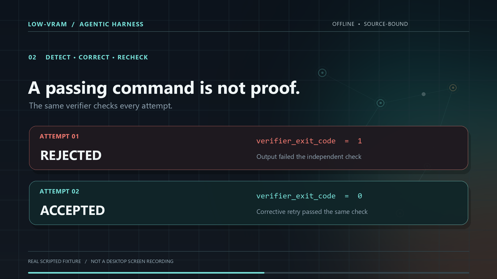

# Source-backed workflow demonstration

**A reproducible, 22-second illustrated replay of a real public-harness
scripted offline fixture — not a screenshot of STUAIM, Pi, a local AI model
or a finished desktop product.**

[Watch the 1080p motion graphic](media/source-backed-workflow.mp4) ·
[View the poster](media/workflow-poster.png) ·
[Inspect the sanitized captured evidence](media/workflow-evidence.json) ·
[Read the exact source example](../examples/enforced-task/README.md)



The supporting illustrated stills show the same captured event sequence:
[opening](media/workflow-opening.png),
[source-bound task](media/workflow-task.png) and
[independent verification](media/workflow-verified.png).
All three are frames of the original motion graphic, not application screenshots.

## What is actually demonstrated

The existing repository [enforced-task example](../examples/enforced-task)
is copied to a disposable work directory and run with Python.
It exercises a script worker, a checked research receipt, the independent
task verifier, corrective feedback and final SSOT project acceptance.
The animated nodes, cards, transitions and labels are **original
illustrations derived from the checked result**, not graphical captures
of the public Pi CLI, a live model prompt, Garden Brain or the private
Agent Home desktop.

| Scene | Truth in the public source | Qualification |
| --- | --- | --- |
| Task intake | `offline-enforced-example` has one admitted source-bound requirement | Existing scripted fixture, not an inferred user request |
| Attempt 01 | Output rejected; task-verifier exit code 1 | Negative result from actual enforcement receipt |
| Feedback | `verification_failure` supplied for bounded retry | Genuine status/feedback classification |
| Attempt 02 | Output accepted; task-verifier exit code 0 | A scripted corrective retry, **not a language model** |
| Final result | `accepted:true`, `complete:true`, verified stage; project authority capped at `tested` | Independent local source/receipt checks, not externally `blessed` |

The final result text is **“accepted: admitted research and corrective
retry were used”**. The source output is SHA-256 bound in the sanitized
JSON receipt. The renderer displays the first twelve hex digits; it
does not independently validate arbitrary user-created screenshots.

No live LLM, GPU, external search engine, phone app, desktop UI, cloud
service, fully autonomous agent chief or scheduled Dream memory manager
was exercised to make this film. The film is intentionally **silent**,
with explanatory text integrated into the frames and no synthetic
voiceover presented as a real user recording.

## Reproduce the observed outcome

From a fresh checkout with the installed Python runtime:

```bash
python examples/media/source-backed-workflow/capture.py
```

This runs the existing public `examples/enforced-task/demo.py` in a
**disposable copy** and prints its bounded, source-linked sanitized
evidence as JSON. Its original working project, generated run IDs and
process traces remain outside the Git tree. The published
[reference evidence](media/workflow-evidence.json) was captured on
Windows and records **SHA-256 of canonical LF-normalized public text
source** (the `canonical_lf_text_sha256` mode), so Linux and Windows
checkouts resolve the same Git text despite Windows CRLF conversion.
The actual output SHA-256 is over the **exact produced bytes** and may
differ between platforms because the scripted example emits native
line endings. This does not change whether the verifier rejected or
accepted the recorded attempts.

To make a new local capture file (choose a path that does not exist):

```bash
python examples/media/source-backed-workflow/capture.py \
  --output my-workflow-evidence.json
```

To author visual frames and the optional local video, install the
separate creative tooling **in your own isolated environment**. The core
harness does not depend on Pillow or FFmpeg:

```bash
python -m pip install Pillow==12.3.0
python examples/media/source-backed-workflow/render.py \
  --evidence my-workflow-evidence.json \
  --output-dir my-workflow-visuals \
  --review-frames --render-video
```

That last step requires an `ffmpeg` executable with H.264 encoding on
`PATH`. The source is editable Python; no proprietary design file,
stock audio, licensed font files or private work-session data is
needed. Poster and video use original shapes, typography rendered
from host fonts, and a restrained teal/brass visual language.

The reference MP4 is **1920×1080, 24 fps, 22 seconds, silent**.
The movie is a diagram-based explanatory animation, not an exact
frame recording of the preceding fixture execution. Review actual
playback and reading time on desktop and phone before wider marketing
use. Programmatic decode and sampled frame checks are necessary
technical gates, not a human artistic or accessibility acceptance.

## Visual verification and remaining limits

The first full-video contact-sheet review found **four scene-handoff
collisions** where old and new headlines overlapped. The rejected first
cut is retained in private QA, not in the public media gallery.
The published revised render uses non-overlapping text-scene intervals.
Two source-only timeline tests independently verify the five scene
windows and demonstrate that an injected overlapping interval is
rejected.

The revised MP4 was decoded across all 528 frames. Twenty-two frames
sampled at one-second intervals were reviewed together, with selected
native stills and a 480×270 decoded phone-size frame. Small technical
metadata becomes difficult to read at phone preview sizes; use the
full-size clip and written evidence for those details. These checks
establish bounded static/technical review, **not independent human
real-time playback or accessibility acceptance**.

The published revised MP4 has SHA-256
`67c7cb496d4e421817aa22b00b85cae20f5b7f50f491251d3e0c862364417bfa`,
size **1,384,372 bytes**, duration **22.000 s** and **528 decoded H.264
frames**. The film has no audio stream.

## Production and source provenance

The **method** was recovered from earlier Garden Brain production
and Codex-session/Gmail review: storyboard/styleframe first, authentic
source evidence, explicit motion hierarchy, dedicated phone-size
checks, restrained visual revisions and separate technical/creative
acceptance. The artwork and source of this particular demo are **new**.

None of the historical Garden Brain/Obsidian images, earlier rendered
MP4s, customer vault, voice tracks, font binaries, Remotion/Shotcraft
source, original Codex conversations, Gmail contents or private
filesystem paths have been copied into this repository.

All public scene claims are tied to
[the sanitized capture](media/workflow-evidence.json),
[the capture script](../examples/media/source-backed-workflow/capture.py),
[the render script](../examples/media/source-backed-workflow/render.py)
and the original public
[enforced-task fixture](../examples/enforced-task/demo.py).

**What this proof does not settle:** useful local-model quality,
an independently accepted Pi/desktop first-run journey, automatic
model/GPU leasing, unassisted user onboarding and long-project
autonomous continuity. These remain separately qualified.
